# Distribuidora Valle Express - Rescate Políglota

**Taller:** Operación Rescate - Persistencia Poliglota

**Materia:** Sistemas Avanzados de Bases de Datos - BD Distribuidas NoSQL y Réplica

**Docente:** Paul Diaz

**Institución:** Universidad de las Fuerzas Armadas ESPE

**Fecha del taller:** 27 de octubre de 2026

### Integrantes

| Integrante | Rol | Responsabilidad |
|---|---|---|
| **Jhonny Remache** | Arquitecto CAP (Líder) | Arquitectura, CAP/PACELC, pruebas de fallo y defensa |
| **Kevin Llumiquinga** | DBA SQL | PostgreSQL, facturas, stock, transacciones ACID y outbox |
| **Mateo Flores** | DBA NoSQL | MongoDB, Redis, Cassandra, catálogo y evidencias documentales |

📄 **Informe completo del taller:** [P1_TallerN3_Grupo4.pdf](P1_TallerN3_Grupo4.pdf)

---

## 1. Contexto

Distribuidora Valle Express guardaba todo en una sola tabla `ventas_todo` de MySQL (MyISAM, una instancia, sin réplica). El Viernes Negro ocurrió lo siguiente:

- **10:00 a 10:05:** un `SELECT ... LIKE '%TV%'` sobre `detalle_productos` bloqueó la tabla durante 45 s y las cajas no pudieron facturar.
- **11:30:** los logs binarios llenaron el disco, el único servidor cayó y no había réplica que tomara el relevo.

Este repositorio contiene la autopsia del fallo, la nueva arquitectura políglota y la evidencia de laboratorio.

---

## 2. Fase 1 – Autopsia del monolito

### ¿Qué teorema violó la empresa?

Violó el **Teorema CAP**. Construyó un sistema "CA": una sola instancia, consistente y disponible mientras nada falle, pero sin tolerancia a fallos y sin réplica (único punto de falla). En la práctica las fallas siempre ocurren, así que la **P** no es opcional, y cuando llegan hay que elegir entre consistencia y disponibilidad:

- El bloqueo de tabla de MyISAM protege la coherencia, pero sacrificó la disponibilidad: las cajas no pudieron facturar. MyISAM tampoco soporta transacciones, así que no había ACID real.
- Con el disco lleno cayó el único servidor y la disponibilidad fue cero.

### 3 tipos de datos mezclados en `ventas_todo`

| Tipo de dato | Ejemplo en el caso | Necesidad |
|---|---|---|
| Transaccional (factura, pago, stock contable) | Una caja registrando una venta | No perder ni duplicar, auditoría, consistencia fuerte |
| Efímero y rápido (carrito, sesión, cache de stock) | 800 usuarios armando su carrito | Milisegundos, alto volumen, expiración automática, tolera pérdida |
| Búsqueda y reportes históricos | El `LIKE '%TV%'` sobre `detalle_productos` | Lectura masiva y agregaciones, tolera datos algo atrasados, no debe competir con las cajas |

### Persistencia políglota vs. polimórfica

- **Políglota:** usar distintas tecnologías de almacenamiento en una misma solución, elegidas por la necesidad y el patrón de acceso de cada dato.
- **Polimórfica:** un mismo almacén guarda datos con estructuras distintas, sin esquema rígido (en el caso, `detalle_productos`: un televisor tiene pulgadas, una refrigeradora tiene litros).
- Se complementan: la solución políglota incluye un motor documental que resuelve la parte polimórfica.

---

## 3. Fase 2 – Diseño políglota

### Diagrama de arquitectura

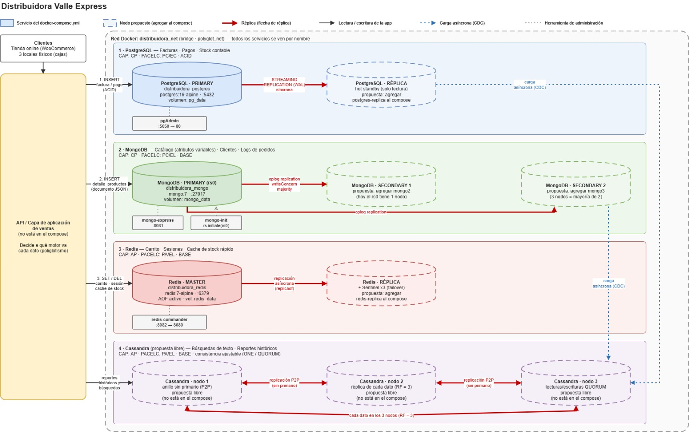

### Tabla de diseño

| Dato | Motor | Justificación teórica | Metodología de réplica |
|---|---|---|---|
| Facturas, pagos, stock contable | **PostgreSQL** | **CP**, **PACELC PC/EC**. Cumple **ACID**: una factura no puede perderse ni duplicarse. Ante una partición prefiere rechazar escrituras antes que divergir, y en operación normal prefiere consistencia sobre latencia. | Streaming replication **síncrona** hacia un hot standby. |
| Catálogo, clientes, logs (estructura variable) | **MongoDB** | **CP**, **PACELC PC/EL**. Modelo documental para atributos variables. **BASE** en lecturas (puede leer secundarios con retraso), pero las escrituras críticas usan `w: majority`. | **Replica set** de 3 nodos con elección automática de primario. |
| Carrito, sesiones, cache de stock | **Redis** | **AP**, **PACELC PA/EL**. **BASE**: latencia mínima, expiración con TTL, tolera perder algún dato efímero. | Master + réplica **asíncrona** con **Sentinel** (×3) para failover, persistencia AOF. |
| Búsquedas y reportes históricos | **Cassandra** | **AP**, **PACELC PA/EL**. **BASE**, consistencia eventual, escrituras y lecturas masivas, sin bloquear a las cajas. | Anillo **masterless** (peer-to-peer), factor de replicación 3, consistencia `QUORUM`. |

> **Nota:** el `docker-compose.yml` del laboratorio levanta **un solo nodo por motor** (MongoDB con replica set de 1 miembro). Los nodos adicionales de la tabla son la propuesta de producción y aparecen con flechas de réplica en el diagrama. En el laboratorio no se levantan.

> **Nota sobre Cassandra:** Cassandra no es un buscador de texto libre. Se modelan tablas por consulta (por ejemplo, producto por categoría y fecha) y no se usa `LIKE '%texto%'`.

---

## 4. Fase 3 – Prueba de supervivencia (laboratorio)

### Archivos

| Archivo | Descripción |
|---|---|
| `Docker-Compose(Original).yml` | Compose entregado por el docente (PostgreSQL, MongoDB, Redis) |
| `Docker-Compose.yml` | Compose modificado: se añadió **Cassandra** (`cassandra:4.1`, puerto 9042, volumen `cassandra_data`) |

### Cómo ejecutar

```bash
docker compose -f Docker-Compose.yml up -d
docker ps
```

Interfaces web: pgAdmin `http://localhost:5050`, mongo-express `http://localhost:8081`, redis-commander `http://localhost:8082`.

### Evidencia

**1. Estado del replica set de MongoDB (`rs.status()`)**

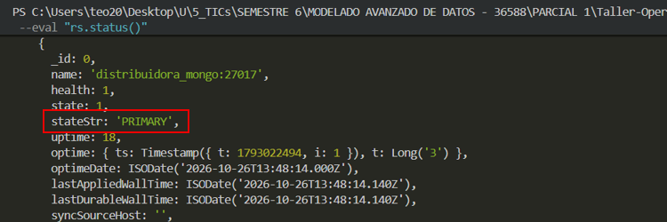

**2. Consulta `SELECT` en PostgreSQL**

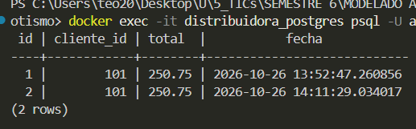

**3. Consulta en MongoDB**

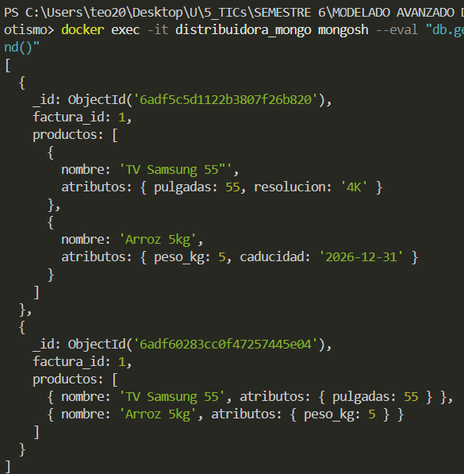

**4. `GET` en Redis**

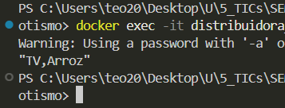

**5. Consulta `SELECT` en Cassandra**

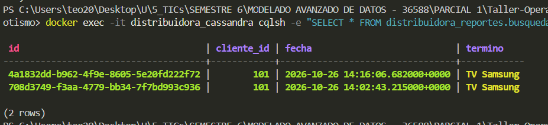

### Plan de caos

Se detuvieron los contenedores de forma controlada para observar qué cae, qué sigue funcionando y qué se pierde.

**Escenario a: se detiene PostgreSQL**
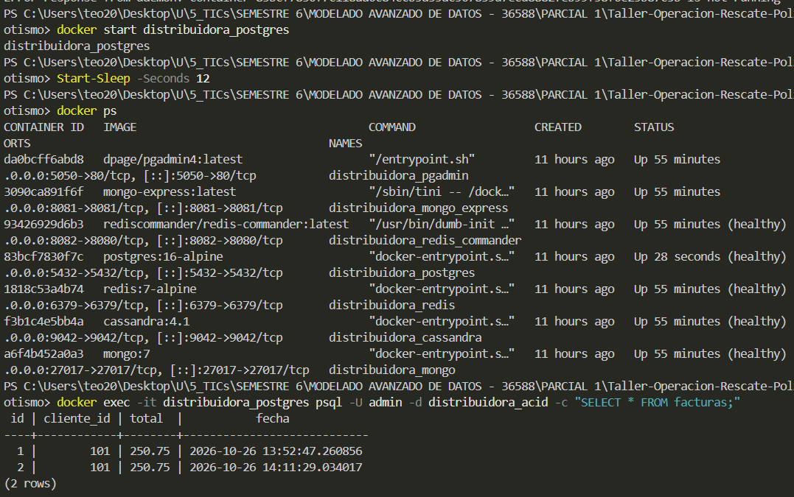
**Escenario b: se detiene MongoDB**
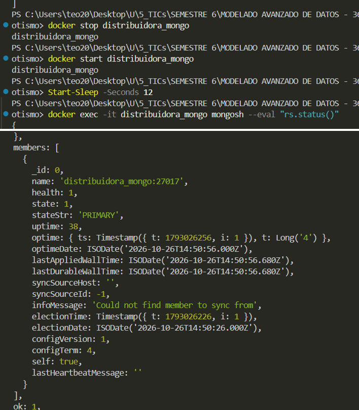
**Escenario c: se detiene Redis**
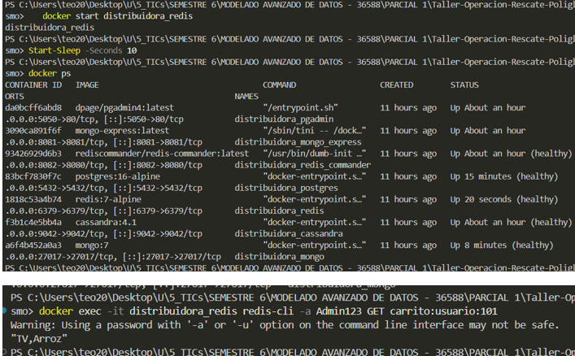
**Escenario d: se detiene Cassandra**
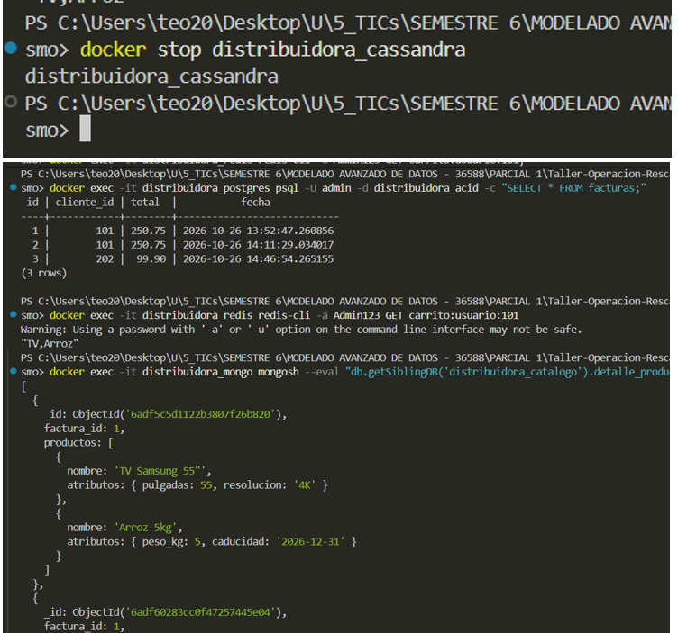

**Estado final de los contenedores**

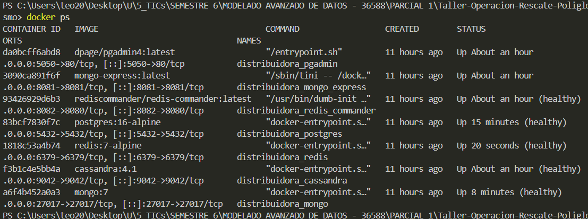

### Tabla de supervivencia

| Falla provocada | Qué cayó | Qué siguió funcionando | Qué se perdió o quedó inconsistente | Justificación (CAP / PACELC) |
|---|---|---|---|---|
| Se detuvo `distribuidora_postgres` | Facturación y pagos | Carrito, sesiones y catálogo | Ninguna venta se confirma sin PostgreSQL; no se acepta la escritura | **CP**: se sacrifica disponibilidad para no registrar facturas inconsistentes |
| Se detuvo `distribuidora_mongo` | Catálogo y clientes | Facturación, carrito y sesiones | Consultas de catálogo no disponibles | **CP**: con un solo nodo no hay primario ni elección posible |
| Se detuvo `distribuidora_redis` | Carrito, sesiones, cache | Facturación y catálogo | Carritos y sesiones activas (datos efímeros) | **AP/BASE**: dato efímero y reconstruible, la pérdida es aceptable |
| Se detuvo `distribuidora_cassandra` | Búsquedas y reportes históricos | Toda la operación de caja | Reportes temporalmente no disponibles | **AP**: no está en el camino crítico de la venta |

**Conclusión:** la caída de un motor ya no tumba toda la operación. El fallo queda **aislado** por tipo de dato, que es la ventaja de la persistencia políglota frente al monolito.

---

## 5. Video de sustentación

## 5. Video de sustentación

🎥 [Ver video del Arquitecto CAP](https://drive.google.com/file/d/1W7wNTwNavIp2UZgJi4TyLDESpvJQg0_0/view?usp=sharing)

## 6. Referencias

- Apache Software Foundation. (s. f.). *Apache Cassandra 4.1 documentation: Dynamo architecture*. https://cassandra.apache.org/doc/4.1/cassandra/architecture/dynamo.html
- MongoDB, Inc. (s. f.). *Replication*. MongoDB Manual. https://www.mongodb.com/docs/manual/replication/
- PostgreSQL Global Development Group. (2024). *PostgreSQL 16 documentation: High availability, load balancing, and replication*. https://www.postgresql.org/docs/16/high-availability.html
- Pritchett, D. (2008). BASE: An ACID alternative. *ACM Queue, 6*(3), 48–55. https://doi.org/10.1145/1394127.1394128
- Redis Ltd. (s. f.). *Redis replication* y *High availability with Redis Sentinel*. https://redis.io/docs/latest/operate/oss_and_stack/management/replication/
---
